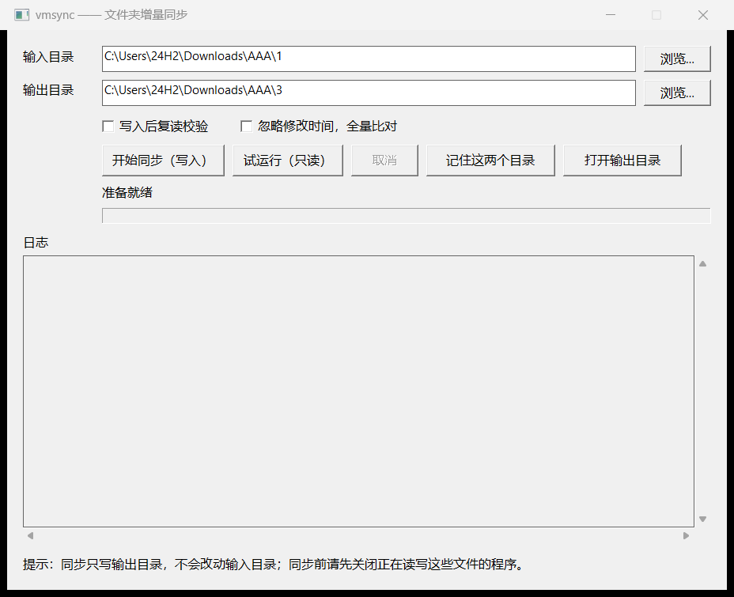

# blocksync —— 大目录/大文件的块级增量同步

工具接收两个目录参数，把「输入目录」增量镜像到「输出目录」：仅写入发生变化的块，内容未变的文件不读取。

常规同步工具以文件为单位：2 GB 的文件修改 100 字节，仍需复制整个 2 GB。blocksync 的最小写入单位为 32 KiB。

适用场景：大文件反复小幅修改；需要在两块磁盘或两台机器之间转移；目标磁盘吞吐较低或写入寿命有限。

主要能力：

- **块级增量**：只写入变化部分，最小写入单位 32 KiB。
- **双向通用**：交换两个目录参数即可反向同步；也可保存配置，后续一条命令完成。
- **索引随数据存放**：索引保存在被同步目录内部，随磁盘一起移动，换机器后可接续使用。
- **三级安全开关**：测试比对（只读，不写数据）、写入后复读校验、忽略修改时间的全量比对。
- **界面与命令行等价**：图形界面不包含独立逻辑，行为与命令行一致。
- **可自检**：附带本地演练脚本，可对完整流程做自动化验证。

---

## 一、快速开始（无需配置）

```bat
dist\blocksync.exe sync "D:\data\project" "E:\backup\project"
```

将 `D:\data\project` 同步到 `E:\backup\project`。首次执行会完整复制，并在两侧目录下各生成一份索引（保存在各自的 `.blocksync` 子目录中）；此后每次仅传输变化的块。

反向同步时交换两个参数的顺序：

```bat
dist\blocksync.exe sync "E:\backup\project" "D:\data\project"
```

仅做比对、不写任何数据文件（测试比对）：

```bat
dist\blocksync.exe sync "D:\data\project" "E:\backup\project" --dry-run
```

测试比对只做读取与比对，不写数据文件、不更新索引；随后的正式同步会按当时的状态重新计算差异。日志逐文件给出状态与变化量：

```text
[1/14] 新增  disk-000001.vmdk  （48.3 MiB）
[3/14] 更新  vmware-0.log  变化块 227.2 KiB（文件共 227.2 KiB）
[14/14] 删除  disk-000002.vmdk（源端已不存在）
```

内容未变化的文件显示为“未变”；结尾给出扫描、改动、删除数量与读取、预计写入的数据量。

### 两条使用约束

1. **路径与文件名必须对应**。同步按相对路径匹配，`A\readme.txt` 仅对应 `B\readme.txt`。两侧文件名不一致时，会被判为一侧新增、另一侧多余。
2. **采用镜像语义**：输出目录中多余的文件将被删除（输入目录中不存在的文件，输出目录亦不保留）。因此输出目录不应指向存放其他数据的文件夹。

---

## 二、命令参考

```
blocksync sync [<输入目录> <输出目录>] [--dry-run] [--full] [--verify]
      省略目录参数时使用 setup 保存的两个目录。
blocksync sync --reverse
      反向同步：目标目录 -> 源目录。

blocksync setup                交互录入或修改本机两个目录
blocksync setup --show         查看当前配置

blocksync status [<目录>]      查看该目录的索引与状态
blocksync verify [<目录>]      全量重算，校验磁盘内容与索引是否一致
blocksync repair [<目录>]      按磁盘实际内容重建索引
```

常用选项：

| 选项 | 说明 |
|---|---|
| `--dry-run` | 测试比对：逐文件报告状态与变化量，并给出读取与预计写入的数据量，不写任何数据文件，也不更新索引 |
| `--verify` | 写入后复读校验：读回已写入的内容并重新计算哈希（会额外读取本次写入的文件） |
| `--full` | 忽略修改时间，全量比对：强制重新读取所有文件内容 |
| `--workers N` | 哈希线程数，默认等于 CPU 核心数 |
| `--lb` / `--sb` | 粗块/细块大小，默认 4 MiB / 32 KiB，两侧必须一致 |
| `--force` | 忽略上次异常退出遗留的目录锁（`.blocksync\lock`） |
| `--yes` | 跳过首次同步与删除前的确认，供脚本无人值守调用 |
| `--allow-mass-delete` | 删除数量超过安全上限时仍继续，确认方向无误后再用 |

退出码：`0` 成功，`1` 失败（错误信息输出到控制台），`2` 参数错误。

---

## 三、工作原理与性能

每次同步执行两个步骤：

1. **对比索引**：两侧各保存一份块哈希索引。若两侧索引均与磁盘内容一致（文件大小和修改时间未变），直接比较哈希即可确定差异块，无需读取文件内容。
2. **仅写入差异**：只读取差异块并按偏移写入目标文件，其余部分保持不变。

| 场景 | 读取量 | 写入量 |
|---|---|---|
| 两侧均无变化 | 不读取 | 不写入 |
| 2 GB 文件内修改 100 KB | 仅读取该文件（索引已失效，需重新计算块哈希） | 约 100 KB |
| 刚从另一侧同步完成 | 仅读取差异块 | 仅写入差异块 |

目标磁盘只需承担几百 MB 至几 GB 的顺序写入，不再承担整个目录的往返复制。

**索引开销**：索引体积约为数据量的 1/1024，保存在各目录下的 `.blocksync` 中（200 GB 数据对应约 200 MB）。

**对齐开销**：写入按 32 KiB 对齐。当修改以大量零散的几十 KB 小块分布时，实际写入量可能达到真实修改量的 2–3 倍；连续写入则几乎没有放大。如需更细粒度，两侧可统一改用 `--sb 16384`（索引体积翻倍）。

### 源目录保护

输入目录的**数据**是只读的：程序只从它读取内容，所有数据写入与删除都发生在输出目录（两侧目录内各自的 `.blocksync` 中会写入索引与状态文件，它们不是数据）。为避免配置失误破坏源数据，写入前还有四道校验，任何一道不通过都会在动手之前停止：

1. **两个目录不得重合或互相包含**。输入目录与输出目录相同、输出目录套在输入目录里、或输出目录包含输入目录，都会直接拒绝——镜像语义会删除输出目录里多出来的文件，一旦嵌套就会波及源文件。
2. **每次写入与删除前复核路径**。实际路径解析链接后若落在输入目录内，或跑出了输出目录，立即中止。
3. **源文件与目标文件不得是同一份数据**。写入前比较两者在磁盘上的身份，硬链接、目录联接等别名会被拒绝。
4. **首次同步或需要删除文件时先列计划再确认**。列出新增、大小变化、需比对与删除的文件数与体积，回答 `y` 才开始写入；脚本无人值守时用 `--yes` 跳过。删除数量超过安全上限（100 个或源文件数的 1%）时另行中止，确认方向无误后加 `--allow-mass-delete`。

目录关系与路径校验只做路径比较，对超大目录几乎没有性能开销；计划摘要只统计文件列表与元数据，不读取文件内容。

---

## 四、日常使用（配置方式）

首次使用时执行一次 `blocksync setup`，按提示填写两个目录：

1. **源目录**：需要同步出去的文件夹，可将文件夹直接拖入窗口。
2. **目标目录**：接收数据的文件夹，填写盘符根目录，例如 `E:\`。

配置保存在 `%LOCALAPPDATA%\blocksync\config.json`，仅对当前机器有效。此后省略目录参数即可使用保存的配置：

```bat
dist\blocksync.exe sync                     离开当前地点前：源目录 -> 目标目录
dist\blocksync.exe sync --reverse --verify  到达目标地点后：目标目录 -> 源目录，写后校验
```

查看当前配置：

```bat
dist\blocksync.exe setup --show
```

同样的操作也可以在图形界面里完成：填好两个目录点“开始同步”；“写入后复读校验”默认已勾选，不需要额外校验时再取消。

---

## 五、图形界面（可选）

不使用命令行时，可直接运行 `dist\blocksync-ui.exe`。该程序不包含同步逻辑，仅根据界面上的目录与选项调用 `blocksync.exe sync`，并显示其输出；因此界面行为与命令行完全一致。



| 控件 | 作用 |
|---|---|
| 测试比对（只读） | 主界面按钮，等价于 `--dry-run`：只读比对，不写任何数据，日志逐文件列出状态与变化量 |
| 菜单“目录” | “记住这两个目录”保存到 `%LOCALAPPDATA%\blocksync\config.json`（与命令行共用）；“打开原目录”“打开输出目录”分别用资源管理器打开输入、输出目录 |
| 输入目录 / 输出目录 + 浏览… | 选择两个目录 |
| 交换 | 对调输入目录与输出目录，用于反方向同步；只改动界面上的两个路径，不动任何文件 |
| 开始同步 | 实际写入输出目录；首次同步或有文件需要删除时，先弹出计划摘要，确认后才开始 |
| 取消 | 中止正在执行的同步；已写入的部分不回滚，下次运行会补齐 |
| 写入后复读校验 | 等价于 `--verify`：写完后读回内容并重新计算哈希，确认写入结果正确；启动时默认勾选 |
| 忽略修改时间，全量比对 | 等价于 `--full`：无论修改时间是否变化，所有文件都重新读取 |

执行期间输入控件会被禁用，进度条按文件数量推进，状态行显示最终结果，下方日志区输出完整信息。日志区跨运行保留：新一次运行在已有内容后追加分隔行（`----- 测试比对 -----` 或 `----- 同步 -----`），不会清空上一次的结果。

`blocksync-ui.exe` 已内置主程序，只使用内置副本：每次启动把它释放到系统临时目录并在同步结束后删除，因此既不需要随包提供 `blocksync.exe`，也不会出现内外版本不一致。只拷贝 `blocksync-ui.exe` 一个文件即可使用。

少数安全软件会把“程序释放并启动另一个可执行文件”识别为可疑行为，这是单文件形态的固有代价；遇到拦截时改用 `dist\blocksync.exe` 直接同步即可，功能完全一致。

---

## 六、文件清单

| 文件 | 用途 |
|---|---|
| `dist\blocksync.exe` | 主程序，单文件，不依赖任何运行时环境 |
| `dist\blocksync-ui.exe` | 图形界面（可选），已内置主程序，可单独使用 |
| `模拟测试.ps1` | 本地演练，自动执行完整流程并自检 |
| `模拟改动.ps1` | 向文件写入精细改动，用于观察增量效果 |
| `build.cmd` | 重新编译两个可执行文件，并把主程序嵌入界面程序（需要 Go 工具链，且 `go` 在 PATH 中） |

`dist` 目录可整体复制到其他 64 位 Windows 机器直接使用；也可以只取 `blocksync-ui.exe` 一个文件。日常流程与各子命令见 `blocksync.exe --help`。

---

## 七、常见问题

| 提示 | 含义与处理 |
|---|---|
| `目录不存在：…` | 盘符变化或路径填写错误。重新执行 `blocksync setup`，或改用显式路径 |
| `目录正被另一个 blocksync 进程使用` | 同一个目录上次异常退出遗留了 `.blocksync\lock`。确认没有实例在运行后加 `--force` |
| `输入目录与输出目录相同` | 参数方向填写错误 |
| `输出目录包含输入目录` | 输出目录是输入目录的上级。镜像删除会删掉输入目录中的文件，请改成互不包含的两个目录 |
| `输出目录位于输入目录之内` | 输出目录是输入目录的子目录，同样会破坏源数据，请改成互不包含的两个目录 |
| `已阻止写入 …：该路径位于输入目录内` | 运行中复核发现目标路径落进了输入目录（多为目录联接或链接所致），已中止 |
| `源文件与目标文件是同一份数据` | 目标文件是源文件的硬链接，写入会同时改掉源文件，已中止 |
| `本次将删除 N 个文件 … 超过安全上限` | 删除数量异常，先确认方向与目录，再决定是否加 `--allow-mass-delete` |
| `未获得确认：当前不是交互终端` | 在脚本或重定向输入中运行时会这样提示；确认无误后加 `--yes` |
| `按排除规则跳过 N 项：…` | 被跳过的只有工具自身的 `.blocksync`、Windows 系统目录与系统文件（见下方“默认排除”），不计入“扫描”数量。列出的前 6 项可用于核对；`扫描 N 个` 与日志里 `[i/N]` 的分母是同一个数 |
| 文件行末尾的 `（源文件修改时间变化）` | 该文件的索引已过期，需要重新读取内容确认差异；只影响读取，不影响写入量 |
| 文件行末尾的 `（源索引不存在）` | 该文件还没有索引（首次同步、新增文件或索引被清理），需完整读取一次；同步后即建立索引 |

**逐文件输出**：每个文件一行，格式为 `[序号/总数] 状态 文件名`，状态取值为 `新增`、`更新`、`未变`、`清空`、`截断`、`删除`。序号连续覆盖全部文件（含删除），因此不会跳号；未变化的文件同样列出，便于核对目录是否被完整扫描。

**默认排除**：只跳过工具自身的 `.blocksync`、Windows 系统目录（`$RECYCLE.BIN`、`System Volume Information`、`$WinREAgent`、`Config.Msi`）与系统文件（`desktop.ini`、`Thumbs.db`、`pagefile.sys`、`hiberfil.sys`、`swapfile.sys`）。日志、锁目录、虚拟机挂起文件等其余内容都会原样同步。
| `verify` 报告"内容不符" | 磁盘文件被修改过（介质错误、手工编辑、上次中断）。若当前内容为最新状态，执行 `repair` 重建索引 |
| `open …: Access is denied`（出现在 `$RECYCLE.BIN` 或 `System Volume Information` 下） | 这两个是 Windows 系统目录，磁盘根目录下必然存在。新版本已默认排除，不会再报错；若仍出现，说明该目录不在默认排除列表中，可把它加入输入目录内 `.blocksync\config.json` 的 `excludes` |

**盘符变化**：移动磁盘更换机器或接口后盘符通常会改变。使用显式路径时需注意；使用配置方式时，若配置的目录不可用，程序会在其他盘符下查找包含 `blocksync` 目录的磁盘并自动切换。

---

## 八、使用要求

1. **同步前关闭正在读写这些文件的程序**，尤其是会持续写入的程序；处于挂起或休眠状态、会遗留内存转储文件的程序应先正常退出。程序不检测虚拟机产生的 `*.lck` 锁目录，也不排除日志、挂起文件（`*.vmem` 等）——它们会按原样同步，因此运行中的虚拟机不会被拦截，也不会自动跳过这些文件，需自行确认已关闭。
2. **单向使用**：不要在两台机器上分别修改同一份目录后互相同步，否则会产生分叉。
3. **输出目录采用镜像删除**，不应指向存放其他数据的文件夹，也不能是输入目录的上级或下级（程序会拒绝，但仍应选择互不包含的独立目录）。
4. 目标目录可以直接填盘符根目录；Windows 的 `$RECYCLE.BIN`、`System Volume Information`、`$WinREAgent`、`Config.Msi` 等系统目录会被自动跳过，既不同步也不会被删除。
5. 目标磁盘建议启用加密（如 BitLocker），其中可能包含账号凭据。
6. 本工具不提供备份功能：同步只保证两份内容一致，误删操作同样会被同步。

---

## 九、已知限制

- 仅同步**文件内容**：不处理权限、ACL、文件属性、备用数据流、符号链接与硬链接；空目录不会被清理。
- 按固定偏移比对：文件内部发生整体插入或删除后，其后的字节全部位移，位移之后的区域会被判定为全部变化。Office 文档（docx/xlsx）每次保存都会重新打包，单个字符的修改也可能导致写入量接近文件本身大小——这是文件格式特性，不是故障。
- 稀疏文件会被实体化：读取到的零按普通数据写入，不会保留空洞，目标端物理占用可能更大。
- 最小写入单位为细块大小（默认 32 KiB）。文件级快速路径依赖大小与修改时间；若内容变更但修改时间未变，需使用 `--full`。
- 不支持裸设备（`\\.\PhysicalDriveN`），仅处理文件。
- 单个文件出错会中止整次同步，没有跳过坏块的选项。
- 单机配置仅保存一对目录；需要同步多对目录时，使用显式路径参数。

---

## 十、部署前本地演练

`模拟测试.ps1` 使用合成文件在临时目录中执行完整流程，共 10 组断言，任一项未通过即返回失败。

```powershell
# 默认：3 个 256 MiB 文件，约 30 秒
powershell -ExecutionPolicy Bypass -File 模拟测试.ps1

# 接近真实规模
powershell -ExecutionPolicy Bypass -File 模拟测试.ps1 -FileMB 1024 -FileCount 2 -ChangeMB 200
```

校验内容：

1. 首次完整传输后，三段目录哈希一致
2. 无改动时报告"已是最新"且零写入
3. 分散原地改写 8 MiB 后，仅写入变更块，远小于全量
4. 反向同步时零读取（两侧索引均有效，不重新读取整盘）
5. 在另一端修改后回传，三段仍一致
6. 新增文件被同步，删除文件被移除
7. 输出目录被外部破坏后可自动修复
8. 文件截断与追加后内容正确
9. 两侧 `verify` 通过
10. `--dry-run` 不改动输出目录中的数据文件

演练数据位于 `%TEMP%\blocksync-rehearsal`，可随时删除。

### 向文件写入精细改动

`模拟改动.ps1` 用于验证"仅传输变化的块"：在文件指定位置原地写入若干小段随机数据，**文件长度保持不变**（不引起字节位移），并预先计算这些改动会命中哪些块、预期同步写入量。

```powershell
# 仅查看修改位置，不写入
powershell -ExecutionPolicy Bypass -File 模拟改动.ps1 "D:\data\project\part-001.bin" -DryRun

# 实际写入 5 处，每处 4 KiB
powershell -ExecutionPolicy Bypass -File 模拟改动.ps1 "D:\data\project\part-001.bin" -Count 5 -Bytes 4096

# 写入前备份
powershell -ExecutionPolicy Bypass -File 模拟改动.ps1 "D:\data\project\part-001.bin" -Backup
```

| 参数 | 说明 |
|---|---|
| `-Count` | 修改处数，默认 5 |
| `-Bytes` | 每处字节数，默认 4096 |
| `-BlockSize` | 细块大小，默认 32768，需与同步时的 `--sb` 一致 |
| `-Seed` | 随机种子，记录后可复现同一组位置 |
| `-NoAlign` | 不保证每处落在不同块内，用于观察跨块情况 |
| `-DryRun` | 仅输出计划，不修改文件 |
| `-Backup` | 写入前复制一份 `.bak` |

输出包含一张表（偏移、块号、块内偏移、长度、是否跨块）和三项结论：数据合计、受影响块数、预期同步写入量。实测两者一致：例如 5 处 × 4 KiB 落在 5 个不同块，脚本预测 160.0 KiB，`sync --dry-run` 报告同为 160.0 KiB。

注意：该脚本会实际破坏文件内容，仅可用于测试副本。

### 正式部署步骤

同步只写入输出目录，不修改输入目录，这一点决定了操作风险：

1. **先执行 `--dry-run`**，确认"读取 / 写入"数值合理（首次写入量应接近全量）。
2. **先执行风险较低的方向**：本机目录 → 目标磁盘。该方向即使失败，也只影响目标磁盘上的副本，原目录不受影响。
3. **执行反方向之前**，先确认目标磁盘上的副本正确（可对其执行 `verify`）。该方向会写入本地目录，建议首次执行前完整备份。

首次在正式目录操作时，也可先指向一份副本目录验证，确认无误后再改为正式目录。

---

## 十一、参考与致谢

块级比对的思路参考了 **idcas**（Incremetal Disk Compare And Sync，作者 Mike Kazantsev）：

- 项目地址：<https://github.com/mk-fg/incremetal-disk-compare-and-sync>
- 借鉴的设计：以「粗块 + 细块」两级哈希定位差异、哈希索引与目标数据分离存放、只覆盖变化的块。

本项目为独立重写：语言（Go）、索引格式、补丁格式、命令行与图形界面均为重新实现，不包含原项目的任何代码或文件。原项目采用 WTFPL v2 许可。
