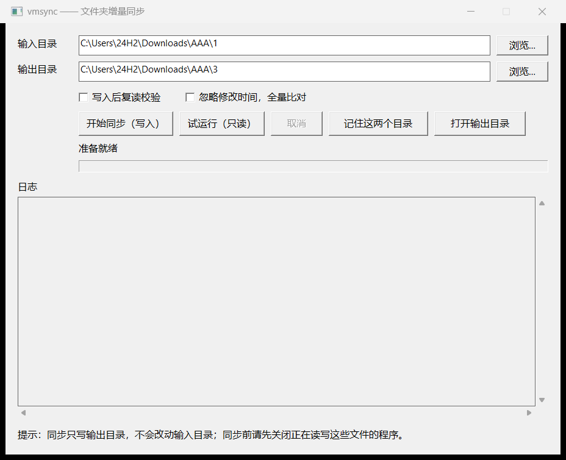

# BlockSync

块级增量同步工具：把一个目录增量镜像到另一个目录，**只写入发生变化的块**，而不是整个文件全量复制。

常规同步工具以文件为最小单位：2 GB 的文件修改 100 字节，仍然要复制整个 2 GB。BlockSync 把文件切成 32 KiB 的块并记录 SHA-256，按块比较差异，一次同步只搬运变化的部分。对大文件反复小幅修改的场景（虚拟机磁盘、数据库文件、磁盘镜像、视频工程），写入量可以下降一到两个数量级。




## 功能特性

- **块级增量**：最小写入单位 32 KiB，2 GB 文件改 100 KB 只写约 100 KB（按 32 KiB 对齐）。
- **跨机可续用**：哈希索引存放在两端的 `.blocksync` 子目录里，随磁盘一起移动，换机器接续使用。
- **双向同步**：交换两个目录参数即可反方向同步；也可以保存本机配置，用图形界面点选。
- **多级安全开关**：测试比对（只读）、写入后复读校验（`--verify`）、忽略修改时间的全量比对（`--full`）。
- **防误操作设计**：输入目录只读；目录嵌套、硬链接改写源、超量删除等均会被拦截；首次同步与删除前需要确认。
- **零依赖单文件**：Windows 64 位，带 GUI 的版本连 CLI 都内置，拷一个 exe 即可运行。

## 适用场景

| 场景 | 说明 |
|---|---|
| 大文件频繁小幅修改 | 虚拟机磁盘（vmdk）、磁盘镜像、数据库文件、工程文件 |
| 两台机器之间搬运数据 | 批量大文件迁移数据，移动硬盘往返 |
| 写入端吞吐低或媒介寿命有限 | 只写变化块，减少迁移耗时与闪存写入量 |
| 内容级一致性校验 | `verify` 全量复算哈希，检验索引与磁盘内容是否一致 |

不适用于：小文件海量散布的目录（收益有限）、需要保留权限/ACL/符号链接的场景、需要多版本历史备份的场景。

## 安装

### 使用预编译版本

Windows 64 位单文件程序，不需要安装，也没有任何运行时依赖：

| 文件 | 说明 |
|---|---|
| `dist/BlockSync-CLI.exe` | 命令行主程序 |
| `dist/BlockSync-GUI.exe` | 图形界面，已内置主程序，可单独使用 |

> `BlockSync-GUI.exe` 不包含任何同步逻辑：它只收集路径与选项，调用 CLI 执行 `sync` 并回显输出，因此界面行为与命令行完全一致。

### 从源码构建

需要 [Go](https://go.dev) 1.27 及以上、Windows 环境（GUI 使用 Win32 调用）：

```bat
build.cmd
```

产物写入 `dist\`：先编译 CLI，再把 CLI 嵌入 GUI（单文件形态）。

自动化测试与本地演练：

```bat
go test ./...                                        :: 单元测试 + 端到端测试
powershell -ExecutionPolicy Bypass -File 模拟测试.ps1   :: 21 项全流程演练，约 30 秒
```

## 快速开始

```bat
dist\BlockSync-CLI.exe sync "D:\data\project" "E:\backup\project"
```

首次执行完整复制，并在两侧各生成一份索引（`<目录>\.blocksync\` 子目录）；此后每次只读有变化的文件、只写变化的块。反向同步交换两个参数即可；只比对、不写任何数据时加 `--dry-run`。


### 使用约束

**复制模式为镜像匹配**：工具采用镜像复制模式，源目录中不存在/被删除的文件，输出目录中的文件也会被**删除**。因此输出目录**不要指向存放其他数据的文件夹**。

## 命令概览

| 命令 | 作用 |
|---|---|
| `blocksync sync <输入> <输出>` | 把输入目录增量镜像到输出目录，`--reverse` 反向 |
| `blocksync setup` | 交互录入或修改本机的两个目录（供 verify/repair/status 与 GUI 使用） |
| `blocksync status / verify / repair <目录>` | 查看索引覆盖 / 校验一致性 / 重建索引 |

常用选项：

| 选项 | 作用 |
|---|---|
| `--dry-run` | 仅比对：逐文件报告状态与读写量，不写数据、不更新索引 |
| `--verify` | 写后校验：写入后读回并重新计算哈希 |
| `--full` | 忽略修改时间，全部文件重读 |
| `--workers N` | 单文件内部的哈希并行度，默认等于 CPU 核数；文件之间仍串行处理 |
| `--lb` / `--sb` | 粗块/细块大小，默认 4 MiB / 32 KiB，两侧必须一致 |
| `--yes` | 跳过首次同步与删除前的确认，供脚本无人值守调用 |
| `--allow-mass-delete` | 删除数量超过安全上限（`max(100, 源文件总数 × 1%)`）时仍继续 |

完整子命令、选项与退出码见 [wiki/命令参考](wiki/命令参考.md)。

## 工作原理

每个文件按两级块划分：4 MiB 粗块（参与内容摘要）与 32 KiB 细块（最小比对与写入单位），索引记录全部细块的 SHA-256。两侧索引都「新鲜」（大小、修改时间、块参数与磁盘一致）时，**零读取**即可算出差异区间，只写入不同区间；否则按需重扫。索引体积约为数据的 1/1024，全部采用「临时文件 + 改名」原子写入，崩溃不留半个索引。

索引格式规范、逐文件决策表、写入路径、性能模型见 [wiki/工作原理与性能](wiki/工作原理与性能.md)。

## 安全与限制

- 输入目录只读；每次写入与删除前按句柄核验目标最终位置，数据不会写进输入目录或输出目录之外。
- 同一目录同时只允许一个进程操作；上次异常退出遗留的目录锁可用 `--force` 接管。
- 不提供备份功能：同步只保证两份内容一致，误删同样会被镜像。
- 不处理权限、ACL、备用数据流、符号链接与硬链接；不保留稀疏文件的空洞。
- 容错以整次同步为单位：单个文件出错会中止，没有跳过坏文件继续的选项。

## 项目文档（wiki）

| 文档 | 内容 |
|---|---|
| [命令参考](wiki/命令参考.md) | 全部子命令、选项与退出码 |
| [工作原理与性能](wiki/工作原理与性能.md) | 架构与包结构、索引二进制格式规范、逐文件决策流程、写入路径与校验、性能模型与已知限制 |
| [源目录保护](wiki/源目录保护.md) | 配置校验、句柄级路径核验、计划确认、删除上限等各道安全机制 |
| [排除列表](wiki/排除列表.md) | 规则语法与匹配算法、默认排除、配置文件结构与存放位置 |
| [图形界面](wiki/图形界面.md) | 单文件嵌入机制、界面与命令行协议、配置管理与日志区行为 |
| [常见问题](wiki/常见问题.md) | 提示语对照、逐文件输出解读、诊断流程 |
| [演练与部署](wiki/演练与部署.md) | 自动化演练脚本的 10 组检查、精细改动模拟、正式部署步骤 |

## 参考与致谢

块级比对的思路参考 [idcas](https://github.com/mk-fg/incremetal-disk-compare-and-sync)（增量磁盘比对与同步，作者 Mike Kazantsev）：以「粗块 + 细块」两级哈希定位差异、哈希索引与数据分离存放、只覆盖变化的块。本项目为独立重写（Go 语言、索引格式、命令行与图形界面均为重新实现），不包含原项目的任何代码。

## 许可证

仓库尚未添加 LICENSE 文件，许可证待定；确定前请先与作者联系获取使用授权。
