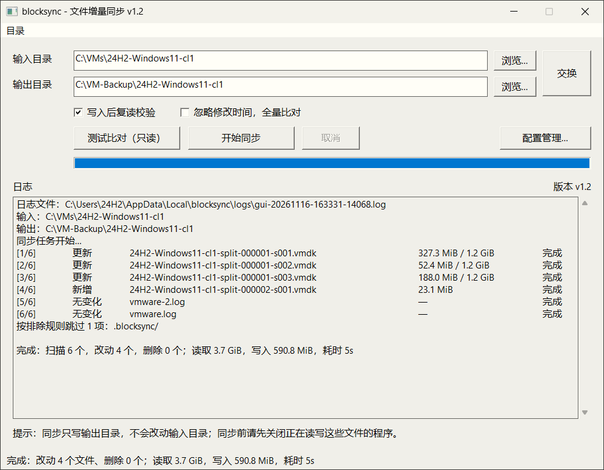

# 图形界面

`BlockSync-GUI.exe` 不包含任何同步逻辑：它只收集路径与选项，调用 CLI 执行 `sync` 并回显输出，因此界面行为与命令行完全一致，界面上的每个按钮都能对应到 CLI 参数。本文说明它的结构与界面协议，供维护与排错。

## 1. 单文件形态与嵌入机制

构建顺序（`build.cmd`）：先编译 CLI，把产物复制到 `cmd\blocksync-ui\embedded\BlockSync-CLI.exe`，再以 `-tags embedcli` 编译 GUI。该标签通过 `//go:embed` 把 CLI 字节整体编入 GUI 二进制（`embed_cli.go`；不带标签编译时 `embeddedCLI` 为空，`ensureExe` 会报「请用 build.cmd 重新构建」）。

每次启动同步时把内置副本**释放到系统临时目录**（`os.CreateTemp`，命名 `blocksync-*.exe`）、以 `CREATE_NO_WINDOW` 和隐藏窗口属性启动、进程退出后立即删除该临时文件。这保证了：

- 不依赖外部 `BlockSync-CLI.exe`，内外版本永远一致；
- 复制 `BlockSync-GUI.exe` 一个文件即可运行。

代价是「程序释放并启动另一个可执行文件」这一行为模式可能被安全软件盯上（defender 启发式拦截释放行为）；遇拦截改用 `dist\BlockSync-CLI.exe` 命令行，功能完全一致。

界面上有两处显示版本：窗口标题末尾（`blocksync - 文件增量同步 v1.3`）与日志区右上角的「版本 v1.3」标签。两处都取自 `internal/version`，与 `blocksync version` 的输出一致，不存在第二份版本定义。

## 2. 界面与 CLI 的进程协议

GUI 与子进程之间只有三条通道，**协议完全落在 CLI 的既有输出上**：

| 通道 | 内容 |
|---|---|
| stdout/stderr 重定向 | CLI 的全部输出经 `os.Pipe` 流回 GUI，逐行进日志队列 |
| stdin 管道 | 只有一种写入：确认环节答复 `y\n` 或 `n\n` |
| 进程退出码 | 0 成功 / 1 失败 / 2 无效子命令（同 CLI） |

GUI 通过解析输出驱动界面（以下模式与常量为两侧契约，改 CLI 输出格式必须同步改 GUI；输出行本身的写法见《命令参考》§输出格式）：

- **进度**：`mirror.ProgressPattern`（`\[(\d+)/(\d+)\]`）匹配 `[i/N]` 逐文件行，驱动进度条位置与状态栏文案；`[i/N] 完成 路径` 也匹配同一模式，但状态词是 `mirror.DoneMarker`（`完成`），不参与进度推进；`[i/N] 哈希计算 路径  体积` 的状态词是 `mirror.CalcMarker`（`哈希计算`），把状态栏切到「正在计算文件哈希…」，同序号结果行到达后恢复「正在处理 i / N 个文件」；
- **状态栏**：`mirror.ResultPattern` 匹配结尾汇总行，解析出改动/删除个数与读写量写进状态栏，并在文案末尾附本次实际耗时；「已是最新」「测试比对…未改动任何数据」等结束语各有对应文案；
- **确认**：CLI 打印 `mirror.ConfirmMarker`（`需要确认后才会开始写入`，CLI 与 GUI 必须一致）后停下等 stdin。GUI 取最近 12 行日志拼成正文（剔除「输入：/输出：」回显与标记行），弹「确认继续吗？」的是/否框，把答案写入 stdin 管道；正文解析为空的少数情形（如刚启动就触发）退化为展示两个目录。

开始提示行（`同步任务开始…` / `测试比对开始…`）与逐文件行里的说明（文件体积、变化量、截断量与原因）只是给人看的，不参与上述解析；原因由 `changeReasons` 整段剥掉，界面不显示。

并发模型：一个读日志协程 + 一个 `cmd.Wait` 协程 + 120 ms 定时器驱动的 `flushUI` 把日志队列落地。读端用 `bufio.Reader` 逐行读取，不设行长度上限；读取中断会在日志里留下「读取中断」一行，不会静默结束。

日志区为只读多行 EDIT 控件，跨运行保留——每次运行都以分隔行开头（`----- 测试比对 -----` / `----- 同步 -----`），日志非空时前面留一个空行。日志内容由 `logModel` 持有，控件只是它的视图：累计超过约 50 万字符时从头部整行丢弃最旧内容，控件与模型保持一致（失步时按模型整体重建）；被丢弃的行仍然完整保留在日志文件里。

日志区按 5 列表格排版：序号 / 状态 / 文件 / 变化量 / 完成。列由控件制表位对齐（`EM_SETTABSTOPS`，列位按客户区宽度的固定比例算），并关闭自动换行（`ES_AUTOHSCROLL`），窗口固定尺寸、列宽只在启动时算一次。一条记录在日志区占一行：`哈希计算` 行到达就追加显示、完成列留空，同序号的结果行（`新增` / `更新` / `无变化` / `删除`）就地替换它，同序号的完成行到达后再把完成列补上，因此一个文件始终只占一行；运行中止或失败时最后一行保留、完成列留空。变化量列直接显示 CLI 行里的说明原文（变短与清空并入 `更新`，显示 `截断到 X`）。文件名列按日志字体实测像素宽度做中间省略（保留首尾、中间 `…`），放得下时不改动。日志文件仍逐行保存 CLI 原始输出（完整路径、说明与原因都在），不受表格化影响。

补完成列不用「删除末行再追加」，而是按该行字符数从控件尾部倒推起点（`EM_SETSEL` + `EM_REPLACESEL`），与追加共一套字符计数；控件与模型字符数不一致时按模型整体重建，与追加路径相同。

追加位置按控件当前文本长度显式算到末尾，不使用插入点：只读控件里 `EM_SETSEL(-1,-1)` 只收起选区、不移动插入点，用户点过或选过日志后插入点会停在中间，按它追加会把新行写进旧内容中间，表现为最新日志卡住不动、错误行反在中间。

日志文件：界面启动时在 `%LOCALAPPDATA%\blocksync\logs\`（`state.LogsDir`）建立 `gui-<启动时间>-<PID>.log`，一次启动一个文件，先写一行启动标记；每读到一行就写入（不经过缓冲），进程被强杀最多丢当前行。每次运行前写一行 `===== 时间 sync 源 -> 目标 [选项] =====`，结束时写 `===== 结束：退出码 N，耗时 T =====`，按运行定位只认这两行。启动时清理超过 7 天、或使日志总量超过 200 MB 的旧文件，只处理本程序生成的 `gui-*.log`。日志目录不可写时界面照常工作，只在日志区提示一次。

### 2.1 锁的处理

- 「测试比对（只读）」在启动前只读检查两侧 `.blocksync\lock` 是否存在，存在时在日志区提示（dry-run 本就没有锁），不弹窗。
- 真同步会真的加锁：若 CLI 因锁退出（退出码 1），GUI 检查两侧锁是否还在，仍存在则弹窗说明后果（两个进程同时写会互相破坏数据与索引），并提示先关闭其它窗口；默认按钮为「否」，选「是」才用同一组参数加 `--force` 重试一次，再失败不再追问，保留失败日志。

### 2.2 超量删除的处理

CLI 在删除数量超过 `max(100, 源文件总数 × 1%)` 时会中止并要求 `--allow-mass-delete`。界面没有这个开关，改为失败后弹窗：正文列出 CLI 的原始提示（要删除多少个、上限多少），提醒先确认输入/输出目录没有填反；选「是」用同一组参数加 `--allow-mass-delete` 重试一次，选「否」保留失败日志。重试后仍失败不再追问。

### 2.3 取消与退出

「取消」弹出确认后 `Process.Kill()` 杀掉子进程。已写入的部分不回滚（下次运行的索引失效机制会自动补齐）。同步未结束时关闭窗口同样询问后强杀。确认弹出的弹窗关闭后由界面线程把主窗口拉回前台（`WM_APP+1` 投递），避免用户焦点滞落在后台窗口。

## 3. 控件与参数对照

| 控件 | 作用 | 对应 CLI |
|---|---|---|
| 输入目录 / 输出目录 + 浏览… | 两个根目录；「交换」对调两者方向 | `sync <输入> <输出>`（直接调换参数顺序） |
| 测试比对（只读） | `--dry-run`，只读执行 | `--dry-run` |
| 开始同步 | 真实写入；首次同步或含删除时弹确认框 | 读确认标记并回写 stdin |
| 取消 | 中止当前运行 | （进程级 `Kill`） |
| 写入后复读校验 | 启动时默认勾选 | `--verify` |
| 忽略修改时间，全量比对 | 全部文件重读 | `--full` |
| 配置管理… | 具名配置的增删改与应用（含排除列表，见 §4） | 共享 config.json |
| 菜单「目录 → 打开原目录 / 输出目录 / 打开日志目录」 | 资源管理器打开对应路径；日志目录不存在时先创建 | — |

运行期间输入框、浏览、交换、复选框、比对/同步/配置按钮全部禁用，仅「取消」可用，防止并发启动第二个子进程。

## 4. 配置管理对话框

`config.json` 是 CLI 与 GUI 共用的持久层（读同一份、每次操作重新读改写、原子保存），枚举细节见《排除列表》。GUI 侧的行为补充：

- 启动时做两件事：`EnsureProfile` 为旧版（只有一对目录）补一条名为「默认」的配置；`seedExcludes` 为尚无排除记录的目录对预填示例规则。用户清空后仍保持为空，不回填。
- 「配置管理…」：列表（名称/输入/输出三列）+ 下方表单。打开时优先选中与主界面目录配对的配置；主界面目录尚无对应配置时以「配置N」草稿形式带出表单（连同该目录对已有的排除规则），点「保存」才成为真配置。「应用并关闭」先保存再把该配置记为生效并回填主界面目录；「删除」只删配置本身，不改主界面目录。配置改名/改目录时排除规则随目录对迁移（详见《排除列表》§3.2）。
- 排除规则在「配置管理…」的「排除列表」框内逐行编辑，保存前逐行语法校验（`scan.ValidatePattern`），不合法的行报「第 N 行不是有效规则」。

## 5. 原生实现说明

GUI 是一个纯 Win32 程序（`syscall` 直接调 user32/gdi32/shell32，不开 cgo），框架要点仅与维护相关：

- 单窗口消息循环锁定在 OS 线程（`runtime.LockOSThread`），以 Per-Monitor V2 DPI 感知运行，布局坐标按系统 DPI 等比缩放；
- 配置管理对话框用内存模板构造，运行时用 `syscall.NewCallback` 注册一次复用；
- 目录选择走 `SHBrowseForFolderW`，「打开目录」走 `ShellExecuteW`。

## 6. 界面排错速查

| 现象 | 原因与处理 |
|---|---|
| 提示「当前界面程序未内置主程序」 | 用非 `embedcli` 标签编译的 GUI，按 README 用 `build.cmd` 重新构建 |
| 确认框内容残缺/缺文件统计 | CLI 输出格式被改动而 GUI 未同步，属两侧契约破坏 |
| 同步被安全软件拦截 | 「释放 exe 再启动」的行为模式被启发式拦截，改用 `BlockSync-CLI.exe` 命令行 |
| 日志列没对齐 | 列位按启动时的字体与客户区宽度算一次；换字体/缩放后重启程序即可。窗口固定尺寸，不支持拖动改变列宽 |
| 日志区看不到很早的行 | 界面只保留最近约 50 万字符，更早的内容按整行丢弃；完整日志在同目录的日志文件里（见 §2） |
| 找不到某次运行的日志 | 打开 `%LOCALAPPDATA%\blocksync\logs\` 下最近的文件，按行内 `===== … sync … =====` 与 `===== 结束 … =====` 定位该次运行 |
